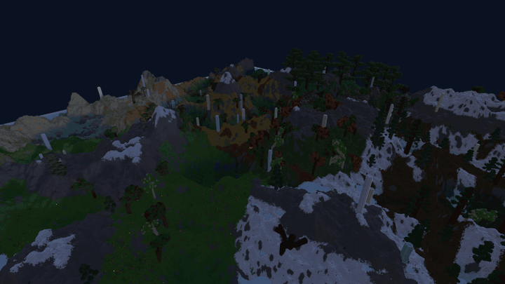
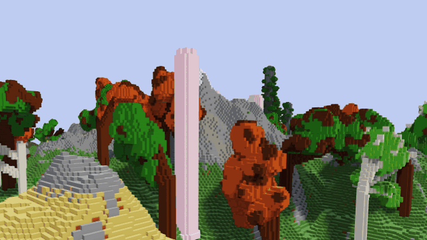
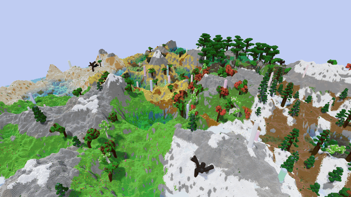
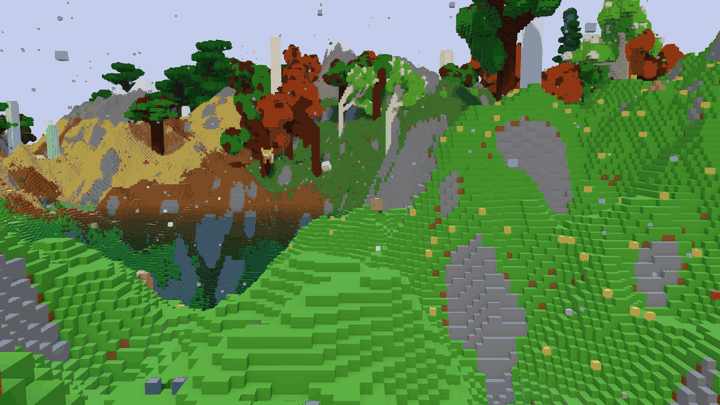
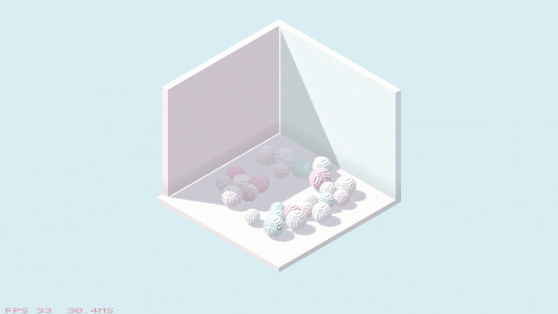
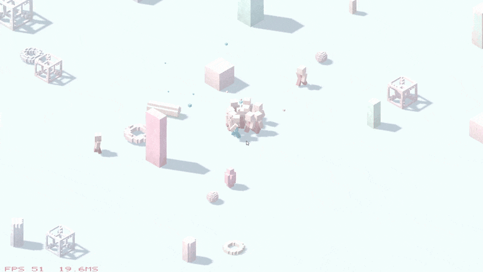
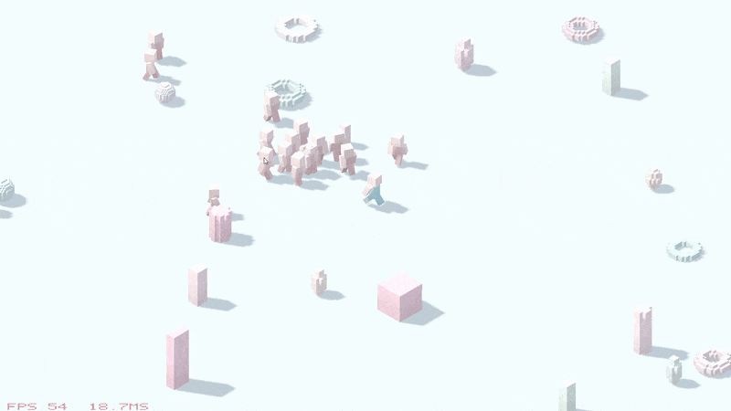

# Patch


> **Work in progress.** A solo research engine (Jan–Apr 2026). It runs on Windows with a Vulkan 1.3 GPU. See [Known limitations](#known-limitations).

GPU-raymarched voxel engine with real-time destruction, procedural terrain and rigid-body physics. Simulation is C23; the Vulkan renderer is C++23 and only reads simulation state.

<p align="center">
  
  
</p>
<p align="center">
  
  
</p>
<p align="center"><sub>Day/night cycle · a pillar cut at its base topples as a rigid body · F4 debug views · rain, snow and fireflies by climate and time of day</sub></p>

## Highlights

- **Compute-shader raymarching**: hierarchical DDA over chunk and region occupancy bitmasks; dynamic voxel objects traced through a BVH.
- **Deferred pipeline**: G-buffer with motion vectors (world positions rebuilt from depth), raymarched shadows (a ray or two per pixel and frame) and AO with temporal accumulation, spatial denoising, TAA over a jittered projection; water tinted by its material.
- **Destruction**: voxel edits trigger connectivity analysis; disconnected islands detach into rigid bodies with debris.
- **Physics**: rigid bodies with GJK/EPA on QuickHull convex hulls, sweep-and-prune broadphase, fixed 60 Hz step, drawn interpolated between steps.
- **Procedural world**: FBM and ridged-noise terrain, 9 temperature/humidity biomes, 18 parametric tree species, flora scatter, water fill, day/night cycle, weather, 8 ambient particle types. A job system generates the world on every hardware thread in about 0.17 s, identical for any thread count, while the loading screen keeps drawing.
- **Tests**: 305 CPU tests in 16 executables covering physics, connectivity, detachment, world generation (identical for any thread count), the job system, profiling budgets and CPU/GPU struct layouts, plus app launch and GPU frame-time tests. A GitHub Actions workflow builds Release and Debug (profiler compiled out) with MSVC, warnings as errors, and runs the CPU tests.

## Status

| Area | State |
| --- | --- |
| Renderer | Working on Windows; Debug builds run clean under the Khronos validation and synchronization-validation layers |
| Destruction & physics | Working; simple impulse solver (see limitations) |
| World generation | One fixed-size world (~154 × 38 × 154 m), no streaming |
| Platforms | Windows |

## Known limitations

- Windows-only app (Win32 window).
- One fixed-size, densely stored world. Launch to a playable world takes under a second in Release on an i9-14900HX; generation is 0.17 s on its 32 hardware threads (1.5 s on one).
- Physics uses a single-pass impulse solver with a diagonal inertia tensor: no joints, no continuous collision, and terrain contact samples box points; objects stacked on other objects rock slightly and never sleep (single-point contacts).

## Roadmap

- Portable window layer (GLFW or SDL) for Linux
- Sparse chunk storage and world streaming
- Iterative contact solver with multi-point manifolds and warm starting

## Build (Windows)

Requires Windows 10 (1703) or later, CMake 3.21+, Ninja, MSVC (Visual Studio 2022 or later) or clang-cl, a Vulkan 1.3 GPU, and the Vulkan SDK. Run the commands below from a Developer Command Prompt (x64), or run `build.bat`, which finds Visual Studio itself, configures, builds and runs the unit tests (`build.bat help` lists the other commands).

```shell
git clone --recursive https://github.com/rmguney/patch
cd patch
cmake -B build -G Ninja -DCMAKE_BUILD_TYPE=Release
cmake --build build
build\patch_samples.exe
```

The app starts in borderless fullscreen; `build\patch_samples.exe --windowed` starts in a resizable window instead (`--windowed 1600 900` sets its client size in pixels).

`set PATCH_MONITOR=1` opens the window on another monitor (0 or unset: the primary; 1, 2, ...: the others, left to right); scripted test runs open there without taking the keyboard focus.

No shader compiler (glslc)? Add `-DPATCH_USE_PREBUILT_SHADERS=ON` to use the checked-in SPIR-V; the Vulkan headers and loader are still required. Debug builds enable the Vulkan validation layers when the SDK is installed.

Tests (the `launch` and `render_perf` tests start the app and need a GPU):

```shell
ctest --test-dir build --output-on-failure -E "launch|render_perf"
```

Add `-DPATCH_RUN_TESTS_ON_BUILD=ON` to run the unit tests after every app build. Wall-clock budget asserts only warn under plain `ctest` (shared CI runners are noisy); set `PATCH_STRICT_PERF=1` to make them fail, as the opt-in post-build test run does.

## Controls

| Input | Action |
| --- | --- |
| Left mouse (hold) | Destroy voxels under the cursor |
| Right mouse (click) | Throw a random voxel shape |
| Right mouse (drag) | Look around |
| WASD, Space / Shift | Move; up / down |
| F2 | Debug overlay: profiler, time-of-day and weather presets |
| F3 | Write `debug_report.txt` (in a scene) |
| F4 / F5 | Next / previous terrain debug view |
| F11 or Alt+Enter | Switch between borderless fullscreen and a resizable window |
| Esc | Pause and resume |

## Architecture

```text
engine/core/       Math, RNG, noise, job system, profiling, spatial hashing
engine/voxel/      Volume storage, occupancy and shadow mips, connectivity
engine/sim/        Scene management, detachment, background loading, env particles, menu state
engine/physics/    Rigid body, collision, particles
engine/render/     Vulkan renderer (render passes as subsystems, barrier helper), UI
engine/platform/   Window and input (Win32), timing and threads (Win32 / POSIX)
content/           Materials, shapes, scene descriptors
game/              World scene, biomes, terrain / tree / shrub / scatter generation, weather, day/night
shaders/           GLSL compute, vertex and fragment shaders
app/               Application entry point
```

## Tools

**voxelize** converts an OBJ mesh to a C voxel shape:

```shell
build\voxelize.exe model.obj output.c --resolution 16
```

## Earlier prototype

Captures from the legacy scenes kept under `.github/legacy` (ball pit, melee, shooter).





## License

[GPL-3.0](LICENSE)
